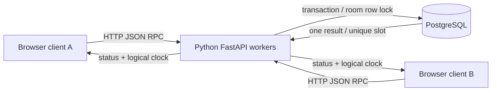

# SlotSync

**One slot. One winner.** A working, AI-assisted educational prototype for Distributed Computing (702CO0C034).

## Problem
Different users can request the same lab equipment at nearly the same time. A client-side availability check is not enough: two clients can both see "available" before either writes. SlotSync uses a shared transaction coordinator to prevent the second reservation.

Live demo: https://slotsync-distributed-booking.vercel.app/

## What runs
- React resource board with fixed one-hour reservations, workspace links, client aliases and manual refresh.
- Python FastAPI HTTP RPC on Vercel; no long-lived server or WebSocket dependency.
- Durable PostgreSQL state, separate from serverless worker memory.
- Concurrency lab sends two real requests to an isolated workspace, then retries one key and reads the saved state.

## Architecture


## Course concepts and exact scope
| Concept | Implementation | Scope |
|---|---|---|
| Communication / RPC | HTTP JSON methods: create workspace, read state, reserve | Request-response RPC style, not Java RMI |
| Mutual exclusion | `SELECT ... FOR UPDATE` locks the shared room row inside a transaction | Centralized durable coordinator, not Ricart-Agrawala |
| Safety invariant | `UNIQUE(room, resource, day, hour)` | At most one stored reservation per fixed-hour slot |
| Logical clocks | Server `max(server, received) + 1`; clients advance after send/receive | Lamport ordering, not physical time or vector clocks |
| Failure semantics | Committed request result saved with idempotency key and fingerprint | Same-key retries replay result; not universal exactly-once delivery |
| Naming | UUID workspaces and fixed resource names map to database records | Application-level naming, not DNS implementation |

A room-level lock serializes different resources too. This is deliberately simple but reduces throughput. The unique constraint remains a second guard. All operations using this API follow the same coordinator. There is no leader election, distributed consensus, replicated database implementation or tested failover claim.

## Setup
Python 3.10+, Node 20+ and PostgreSQL. Set `DATABASE_URL` to a PostgreSQL connection URL (SSL when required). Never commit credentials.

```sh
npm install
python3 -m venv .venv
. .venv/bin/activate
pip install -r requirements.txt
export DATABASE_URL='your-private-connection-url'
uvicorn api.index:app --reload --port 8000
# second terminal
npm run dev
```
The Vite development proxy forwards `/api` to port 8000. Schema is initialized by the backend. For a larger service, replace request-time schema checks with controlled migrations.

### Vercel
Import this repo, use Vite, and keep `npm run build` and `dist`. Connect a dedicated Postgres database through Vercel Storage so `DATABASE_URL` is supplied to the server, then redeploy. `vercel.json` routes API paths to the Python function. Do not put database URLs into `VITE_*` variables.

## Demo / viva
1. Create a workspace. Open its copied link on a second device.
2. Use aliases Client A and Client B. Reserve the same resource/hour.
3. Refresh the second client: there should be one stored booking.
4. Open Concurrency lab and run the isolated race. Observe 201/409 responses and same-key replay.
5. Explain why an in-memory lock in one serverless worker would not coordinate another worker.

## Limits and safety
- Demo, not an official campus booking service. No real personal data, emails or student IDs.
- Workspace link is a bearer capability, not verified login. Anyone with it can read aliases and reserve.
- No cancellation, admin authorization, rate-limited account layer or production retention policy.
- Manual refresh only. No automatic polling or live push.
- Reservations are fixed local-date/hour labels; no cross-time-zone calendar conversion.
- 500 event limit per workspace. Free database/hosting quotas may pause service; no uptime promise.
- A failed HTTP response does not prove the database did not commit. Retry the same key, not a new key.

## Academic use
Built with AI assistance. This repository does not claim the code was independently written by a student or a student team. The supplied course policy forbids GenAI for faculty assignments and expects original assessed work. Use as a learning reference unless the faculty permits this assistance. Review, understand, adapt and disclose help before assessed use.

## References
- Course policy: Distributed Computing 702CO0C034, supplied NMIMS 2026-27 document.
- PostgreSQL unique constraints: https://www.postgresql.org/docs/current/ddl-constraints.html
- PostgreSQL explicit locking: https://www.postgresql.org/docs/current/explicit-locking.html
- Vercel Python runtime: https://vercel.com/docs/functions/runtimes/python
- Lamport, Time, Clocks, and the Ordering of Events in a Distributed System: https://lamport.azurewebsites.net/pubs/time-clocks.pdf

Install the test tools with `pip install pytest httpx`, then run `SLOTSYNC_URL=https://slotsync-distributed-booking.vercel.app python -m pytest test_api.py -q`. See `test_api.py` for executable live integration tests. Results should be measured against the deployment, not assumed from the design.

## Verified deployment evaluation (14 October 2026)
Ten live API integration tests passed on the deployed app: health, two-client conflict, same-key replay, reused-key mismatch, received-clock update, invalid resource, invalid hour, workspace isolation, invalid workspace ID and missing workspace. One UI race returned a 409 conflict for Client A and a 201 success for Client B, replayed Client A's 409, and showed one saved reservation. This is a small functional check, not a load test or proof of fault-tolerant availability.
